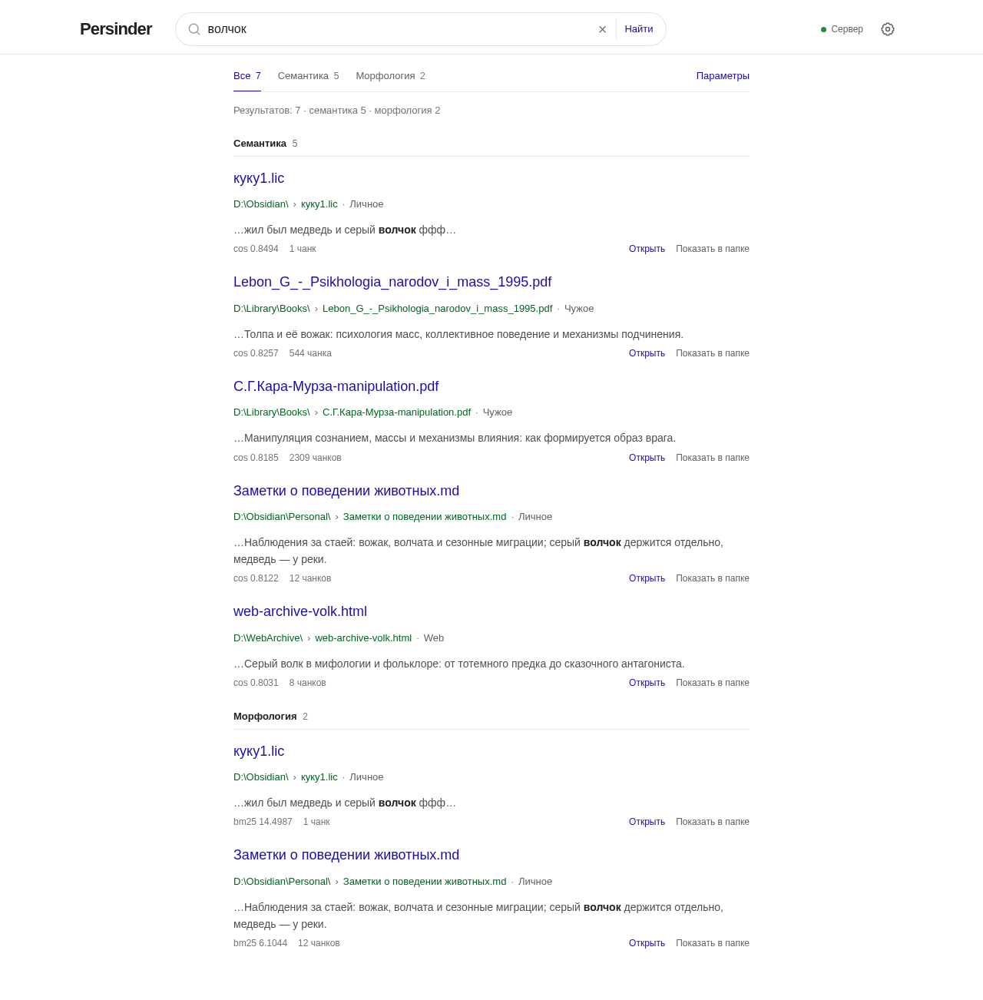
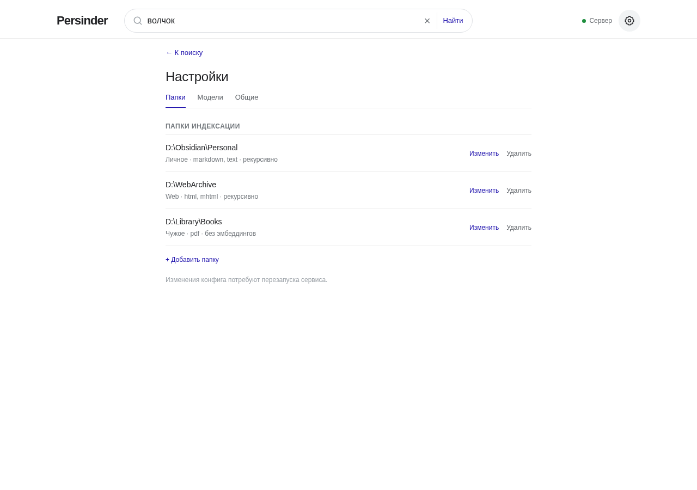
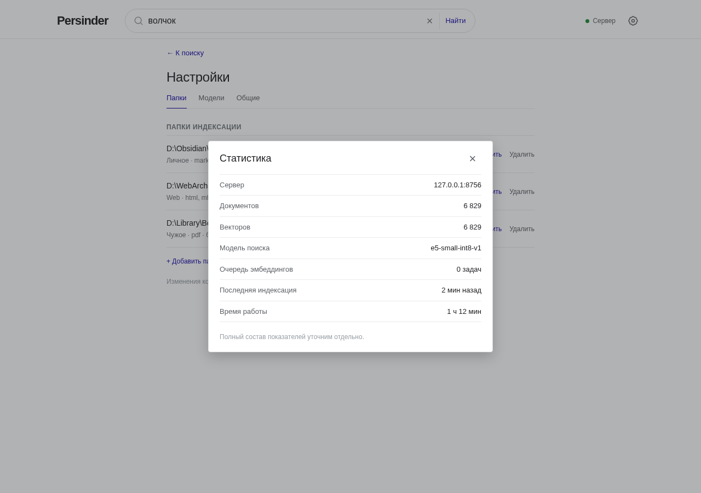
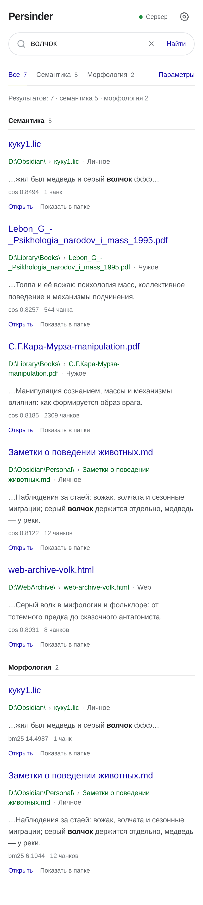
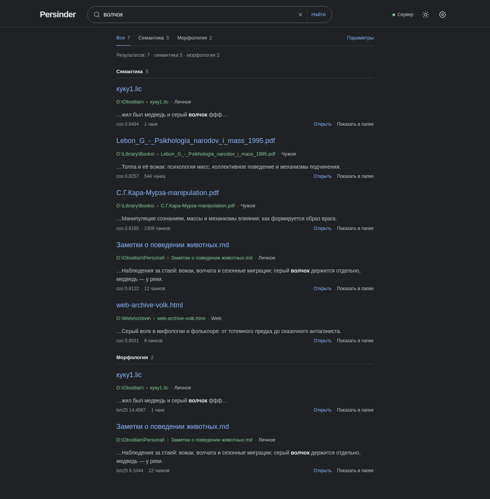
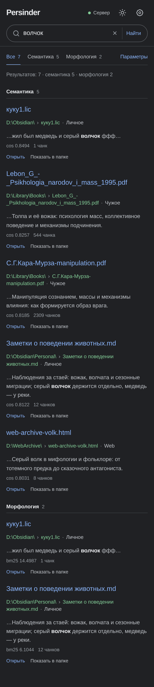

# Эскиз страницы поиска

Статический прототип без сборки и зависимостей: HTML + CSS + JS. Нужен, чтобы
согласовать раскладку, состояния и мобильное поведение до переноса в Vue.

Оформление — плоское, в духе раннего Google: белый фон, тонкие линии, синие
ссылки, зелёный путь к файлу. Никаких карточек, теней, боковых панелей и
имитации «дашбордов».

## Как открыть

Просто откройте `index.html` в браузере. Если браузер ограничивает `file://`,
поднимите локальный сервер:

```bash
cd web/mockups/search
python3 -m http.server 8080
# http://127.0.0.1:8080
```

## Что можно потрогать

- поиск по демо-данным (кнопки-подсказки «волчок», «медведь», «серый волчок»);
- вкладки слоёв: все / семантика / морфология, у каждой — счётчик;
- «Параметры»: `min_score`, `morph_limit`, `semantic_limit`;
- «Настройки» (шестерёнка справа): вкладки «Папки», «Модели», «Общие»;
- статус сервера в шапке: при наведении — адрес и число векторов, по клику —
  модальное окно статистики;
- светлая и тёмная тема: кнопка в шапке, выбор запоминается; по умолчанию берётся
  системная настройка;
- мобильная раскладка: сузьте окно или откройте DevTools → device toolbar;
- действия «Открыть» и «Показать в папке» показывают тост — в приложении это
  будут серверные вызовы.

## Скриншоты

| Поиск | Настройки |
|---|---|
|  |  |

| Статистика | Мобильный |
|---|---|
|  |  |

| Тёмная тема | Тёмная тема, мобильный |
|---|---|
|  |  |

## Состояния

- пустой запрос — очистите поле;
- «ничего не найдено» — введите слово, которого нет в демо-данных, например
  `абракадабра`;
- ошибка сервера — откройте `index.html?error=1`;
- произвольный запрос — `index.html?q=медведь`;
- настройки сразу — `index.html?view=settings&panel=models`;
- статистика сразу — `index.html?stats=1`.

## Что переносим в Vue

- токены оформления из `:root` → CSS-переменные;
- `AppHeader.vue` — логотип, поиск, статус, настройки;
- `SearchView.vue` — вкладки слоёв, параметры, список результатов;
- `ResultRow.vue` — строка хита: заголовок, путь, сниппет, метрики, действия;
- `SettingsView.vue` — вкладки «Папки», «Модели», «Общие»;
- `StatsDialog.vue` — статистика сервера;
- `useSearch.ts` — состояние запроса, debounce, отмена предыдущего запроса;
- `useFilters.ts` — лимиты и `min_score`;
- `useServerStatus.ts` — состояние сервера и статистика;
- `useTheme.ts` — светлая/тёмная тема и запоминание выбора.

Данные в эскизе демонстрационные и не совпадают с реальной БД.
